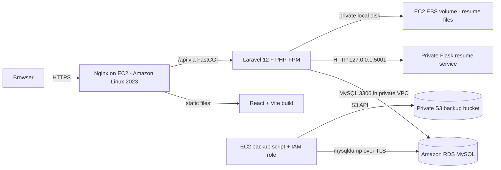
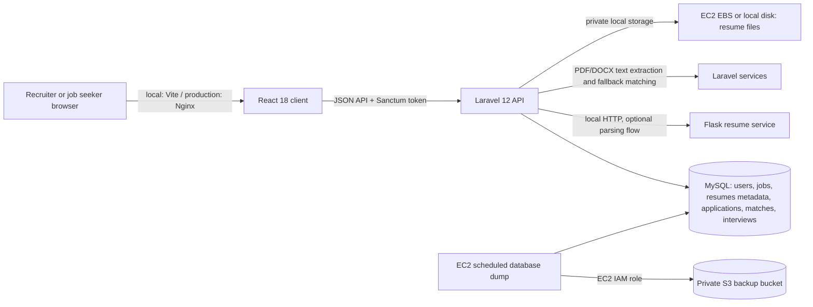
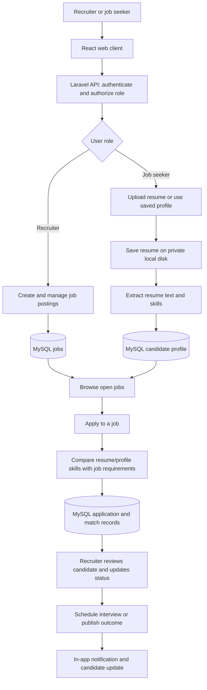
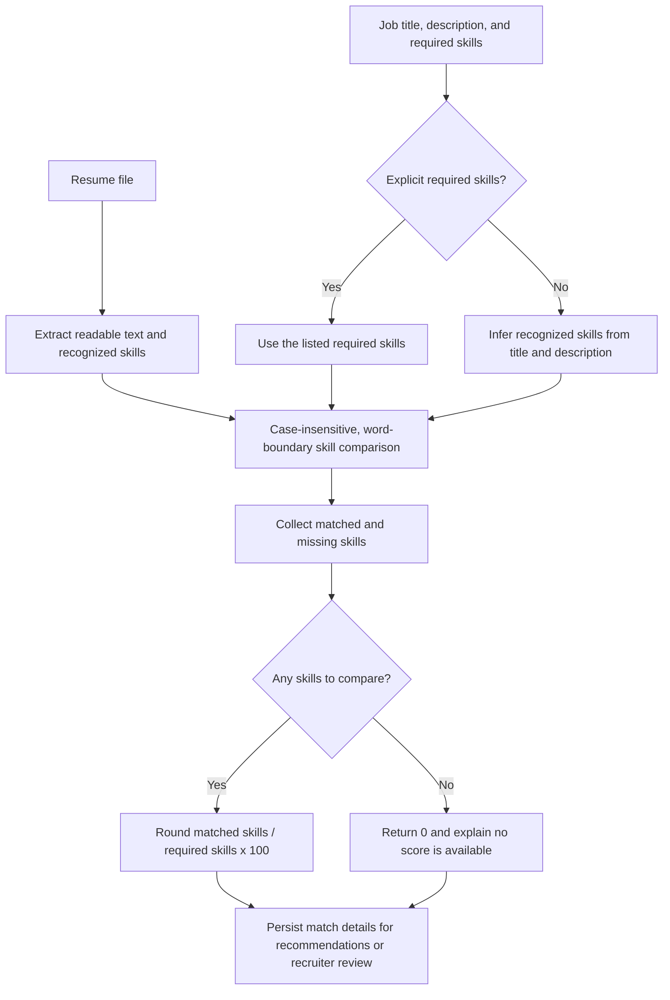

# HireFlow — AI-Powered Job Recruitment & Applicant Tracking System

[](https://react.dev/)
[](https://laravel.com/)
[](https://laravel.com/docs/sanctum)
[](https://flask.palletsprojects.com/)
[-ff9900?logo=amazon-aws&logoColor=white)](https://aws.amazon.com/)
[](https://www.mysql.com/)
[](LICENSE)

**HireFlow** is a modern, role-separated recruitment platform and Applicant Tracking System (ATS). It connects hiring teams and candidates through dedicated workspaces: **Recruiters** manage job postings, parse candidate resumes, and track applicants with automated screening scores, while **Job Seekers** discover openings with interactive analytics, upload resumes for skill extraction, and track applications through interview and offer stages.

## Project Details and Technology Stack

| Area | Technology | Responsibility |
|---|---|---|
| Web client | React 18, React Router 7, Vite 6, Lucide React | Recruiter and job-seeker dashboards, job discovery, forms, and application tracking |
| REST API | PHP 8.2+, Laravel 12, Laravel Sanctum | Authentication, role authorization, job/application workflows, interviews, and notifications |
| Database | MySQL 8 / MariaDB; SQLite is configured for local automated tests | Users, jobs, extracted resume data, applications, matches, interviews, and notifications |
| Resume and matching service | Python 3, Flask, pypdf, python-docx | Optional HTTP resume parsing, contact/skill extraction, and explicit skill-overlap scoring |
| Built-in fallback | PHP `LocalAiMatcher` | Local skill extraction and matching when the Python service is unavailable |
| File storage | Laravel private local disk by default | Uploaded resume files; deployed files reside on the EC2 instance's private EBS volume |
| AWS deployment | Amazon Linux 2023, EC2, RDS for MySQL, S3, Nginx, PHP-FPM, systemd | Hosts the app, stores relational data, and can store database backup files |

> **Storage note:** The resume controllers explicitly use Laravel's `local` disk. Setting `FILESYSTEM_DISK=s3` alone does not move resume uploads to S3. The deployment guide below uses S3 for database backups and keeps resumes private on EC2; S3 resume storage requires a code change.

HireFlow is an ATS workflow application, not an email-delivery service or an automated hiring decision system. Interview updates are stored as in-app notifications. Match percentages are heuristic skill-overlap indicators and should support, not replace, human review.

---

## 📑 Table of Contents

1. [Project Details and Technology Stack](#project-details-and-technology-stack)
2. [⚡ Quickstart: Local Setup Guide](#-quickstart-local-setup-guide)
3. [☁️ AWS Console Deployment: Amazon Linux 2023, EC2, RDS, and S3](#️-aws-console-deployment-amazon-linux-2023-ec2-rds-and-s3)
4. [🏗️ System Architecture and Application Flow](#️-system-architecture-and-application-flow)
5. [🚀 Key Features](#-key-features)
6. [🤖 Explainable Skill-Overlap Matching](#-explainable-skill-overlap-matching)
7. [🔌 API Endpoints Reference](#-api-endpoints-reference)
8. [📂 Project Directory Structure](#-project-directory-structure)
9. [🛠️ Troubleshooting & FAQs](#️-troubleshooting--faqs)

---

## ⚡ Quickstart: Local Setup Guide

Follow these step-by-step instructions to get HireFlow running on your local machine.

### 📋 Prerequisites

Ensure you have the following installed before starting:
- **PHP 8.2 or higher** ([Download PHP](https://windows.php.net/download/) or install via [XAMPP](https://www.apachefriends.org/))
- **Composer 2.x** ([Download Composer](https://getcomposer.org/))
- **Node.js (v18+) & npm** ([Download Node.js](https://nodejs.org/))
- **MySQL 8.0+ / MariaDB** (bundled with XAMPP)
- **Python 3.9+ & pip** ([Download Python](https://www.python.org/))
- **Git** ([Download Git](https://git-scm.com/))

---

### Step 1: Database Setup (MySQL)

1. Open the **XAMPP Control Panel** and start **MySQL** (and **Apache** if using phpMyAdmin).
2. Open your browser and navigate to `http://localhost/phpmyadmin`.
3. Create a new database named **`resume_ats`** with collation `utf8mb4_unicode_ci`:
   ```sql
   CREATE DATABASE IF NOT EXISTS resume_ats CHARACTER SET utf8mb4 COLLATE utf8mb4_unicode_ci;
   ```

---

### Step 2: Backend Setup (Laravel 12 API)

Open a **PowerShell** or terminal window in the project root (for example, `C:\xampp\htdocs\AWS-based-applicant-tracking-system`):

```powershell
# 1. Navigate to the backend directory
cd backend

# 2. Copy the environment configuration file
if (-not (Test-Path .env)) { Copy-Item .env.example .env }

# 3. Install PHP dependencies
composer install

# 4. Generate the application encryption key
php artisan key:generate

# 5. Verify database credentials in backend/.env:
#    DB_CONNECTION=mysql
#    DB_HOST=127.0.0.1
#    DB_PORT=3306
#    DB_DATABASE=resume_ats
#    DB_USERNAME=root
#    DB_PASSWORD=

# 6. Run database migrations and base seeders
php artisan migrate --seed

# 7. Start the Laravel development server
php artisan serve --host 127.0.0.1 --port 8000
```

> 🟢 **Backend status:** The API will be available at `http://127.0.0.1:8000/api`. Keep this terminal open.

> **Shared recruiter workspace:** The default `RECRUITER_SHARED_EMAILS` setting gives the Alex and Morgan recruiter accounts the same jobs and applicant workflow. Update the comma-separated setting in `backend/.env` if those account emails change, then run `php artisan config:clear` (or rebuild the config cache) and restart the API.
>
> The Sandy recruiter and John job-seeker accounts see job IDs 100–2200 in their job lists. John's applications to Sandy's jobs appear in Sandy's recruiter workspace.

> **Interview updates:** The Interview Management workflow stores applicant updates as authenticated in-app notifications. It does not claim email delivery. The legacy application-status endpoint can send an email only when a delivery mailer is configured; the example `MAIL_MAILER=log` writes to the Laravel log instead of delivering it.

---

### Step 3: Frontend Setup (React 18 + Vite)

Open a **second** terminal window in the project root:

```powershell
# 1. Navigate to the frontend directory
cd frontend

# 2. Copy the environment configuration file (optional, defaults work out-of-the-box)
if (-not (Test-Path .env)) { Copy-Item .env.example .env }

# 3. Install npm dependencies
npm install

# 4. Start Vite development server
npm run dev
```

> 🟢 **Frontend status:** Vite serves the frontend at **`http://localhost:5173`** and proxies `/api` calls directly to `http://127.0.0.1:8000`. Keep this terminal open.

---

### Step 4: AI Resume Parsing Microservice (Python Flask)

The Python service parses PDF/DOCX resumes and performs skill extraction and candidate-job matching.

Open a **third** terminal window in the project root:

```powershell
# 1. Navigate to the AI service directory
cd ai_services

# 2. Create and activate a Python virtual environment
python -m venv .venv
.\.venv\Scripts\Activate.ps1

# (If PowerShell blocks script execution, run: Set-ExecutionPolicy -Scope Process -ExecutionPolicy Bypass)

# 3. Install Python dependencies
python -m pip install --upgrade pip
python -m pip install -r requirements.txt

# 4. Start the Flask AI microservice
python app.py
```

> 🟢 **AI Service status:** Microservice starts at `http://127.0.0.1:5001`. Verify via `http://127.0.0.1:5001/health`. Keep this terminal open.

---

### Step 5: Demo Data & Initial Accounts

To quickly test the application with realistic data:

1. **Create a Recruiter Account:**
   - Visit `http://localhost:5173/recruiter/register`.
   - Register a recruiter account (e.g., `recruiter@company.com`).
2. **Seed 50 Demo Jobs:**
   - Once at least one recruiter account exists, open a terminal in `backend/` and run:
     ```powershell
     cd backend
     php artisan db:seed --class=DemoJobSeeder
     ```
   - This automatically creates **50 open jobs**: five each in Software Engineering, DevOps & Cloud, Data & Analytics, AI & Machine Learning, UI/UX Design, Sales, Human Resources, Cybersecurity, Quality Assurance, and Marketing. Rerunning is safe and closes obsolete demo listings without deleting their history.
     - To assign all 50 jobs to one recruiter instead, run:
       ```powershell
       php artisan tinker --execute="app(Database\Seeders\DemoJobSeeder::class)->seedFor(App\Models\User::where('email', 'recruiter@company.com')->firstOrFail());"
       ```
3. **Create a Job Seeker Account:**
   - Visit `http://localhost:5173/user/register`.
   - Register a candidate account (e.g., `candidate@example.com`).
   - Fill in skills (e.g., `React, Laravel, MySQL, TypeScript`) to unlock tailored recommendations!

---

### 🌐 Service Endpoints & Ports Summary

| Service | Technology | Local URL | Port | Notes |
|:---|:---|:---|:---:|:---|
| **Web Frontend** | React 18 + Vite | `http://localhost:5173` | `5173` | Role-based UI & Dashboards |
| **Backend REST API** | Laravel 12 + Sanctum | `http://127.0.0.1:8000` | `8000` | Auth, Storage, Business Logic |
| **AI Microservice** | Python 3 + Flask | `http://127.0.0.1:5001` | `5001` | PDF/DOCX Parsing & NLP Matching |
| **Database Server** | MySQL / MariaDB | `127.0.0.1:3306` | `3306` | Database: `resume_ats` |

---

## ☁️ AWS Console Deployment: Amazon Linux 2023, EC2, RDS, and S3

This deployment keeps the app on one Amazon EC2 instance, the MySQL database on private Amazon RDS, and database export files in a private S3 bucket. The EC2 instance runs the React build, Nginx, Laravel/PHP-FPM, and the Flask service. Use one AWS Region for all resources.

> **Important application behavior:** Resume upload and download code explicitly uses Laravel's private local disk. It stores files on the EC2 EBS volume; setting `FILESYSTEM_DISK=s3` does not switch these controllers to S3. In this guide, S3 is for database backup files only. Do not delete the EC2 volume while it contains the only copy of resumes.

### AWS Deployment Architecture



### AWS Free Tier and Cost Checks

AWS offers different plans and Free Tier terms depending on account age and eligibility. AWS currently advertises up to **$200 in credits over up to six months** for eligible new customers; this is not a permanent free hosting plan. Review the current [AWS Free Tier terms](https://aws.amazon.com/free/), [Free Tier FAQs](https://aws.amazon.com/free/free-tier-faqs/), and [RDS offer details](https://aws.amazon.com/rds/free/) before creating resources. Older accounts may be governed by legacy offers.

Before launching:

1. In the AWS Console, select a single Region and open **Billing and Cost Management**.
2. Create a budget and billing alerts. Alerts notify you; they do not stop resources or guarantee a zero bill.
3. Use only instance/database choices that the console marks eligible for your account and Region. Do not assume a size is free because an older tutorial lists it.
4. Check EBS volumes, public IPv4 addresses, RDS storage/backups, data transfer, and S3 storage/requests; these can consume credits or incur charges.
5. This is a learning deployment, not a highly available production design. Protect real resumes with HTTPS, private database networking, least privilege, backups, and access controls.

### Step 1: Create a Private S3 Backup Bucket

1. In the AWS Console, choose **S3** → **Create bucket**.
2. Choose a globally unique name, for example `hireflow-db-backups-<unique-suffix>`, and select the same Region you will use for EC2 and RDS.
3. Keep **Block all public access** enabled and leave ACLs disabled.
4. Keep default server-side encryption enabled (SSE-S3 is sufficient for this example).
5. Create the bucket. Backup objects will be stored under the `database/` prefix.
6. Optionally add an S3 lifecycle rule to expire old database dumps after a retention period you choose. Check storage and request costs before enabling versioning or replication.

Do not make the bucket public. The application does not currently store resume uploads in this bucket.

### Step 2: Create an EC2 IAM Role for S3 Backups

Do not create long-lived IAM access keys or run `aws configure` on the instance. Use an EC2 instance role so AWS supplies temporary credentials.

1. In **IAM** → **Policies** → **Create policy** → **JSON**, create a policy for the one bucket. Replace the bucket name:

   ```json
   {
     "Version": "2012-10-17",
     "Statement": [
       {
         "Effect": "Allow",
         "Action": ["s3:GetBucketLocation", "s3:ListBucket"],
         "Resource": "arn:aws:s3:::hireflow-db-backups-<unique-suffix>",
         "Condition": {
           "StringLike": {
             "s3:prefix": ["database/*"]
           }
         }
       },
       {
         "Effect": "Allow",
         "Action": ["s3:GetObject", "s3:PutObject"],
         "Resource": "arn:aws:s3:::hireflow-db-backups-<unique-suffix>/database/*"
       }
     ]
   }
   ```

2. Name the policy `HireFlowDatabaseBackup`.
3. In **IAM** → **Roles** → **Create role**, choose **AWS service** → **EC2** as the trusted entity.
4. Attach `HireFlowDatabaseBackup`, name the role `HireFlowEC2Role`, and create it.
5. Attach this role to the EC2 instance during launch (or afterward using **Actions** → **Security** → **Modify IAM role**).

The role is limited to listing, uploading, and restoring backup objects in this bucket. It does not grant S3-wide access.

### Step 3: Create a Security Group and Launch Amazon Linux 2023 on EC2

1. In **EC2** → **Security Groups**, create `hireflow-web-sg` in the default VPC (or your chosen VPC).
2. Add inbound rules:
   - SSH, TCP 22, **My IP** only.
   - HTTP, TCP 80, `0.0.0.0/0` (and `::/0` if using IPv6).
   - HTTPS, TCP 443, `0.0.0.0/0` (and `::/0` if using IPv6).
   - Do **not** add public rules for MySQL 3306 or Flask 5001.
3. In **EC2** → **Launch instance**, choose:
   - Name: `hireflow-web`.
   - **Application and OS image (AMI): Amazon Linux 2023 AMI**, 64-bit x86. Do not choose Ubuntu or Amazon Linux 2 for these steps.
   - An instance type explicitly marked eligible for your account/Region. For a small learning instance, start with the smallest eligible size; building the frontend and parsing large PDFs may exceed its memory.
   - A key pair you create and download. Keep the private key only on your computer.
   - Network: the VPC used for RDS, a public subnet, and a public IPv4 address so users can reach Nginx.
   - Security group: `hireflow-web-sg`.
   - Advanced details → IAM instance profile: `HireFlowEC2Role`. Require IMDSv2 if the option is available.
   - Keep the root EBS volume small; review its estimated cost and free allowance.
4. Launch the instance and wait for **Running** and passing status checks.

### Step 4: Create a Private Amazon RDS for MySQL Database

1. In **RDS** → **Databases** → **Create database**, select **Standard create**, **MySQL**, and a supported MySQL 8.x version.
2. Select the Free Tier/Free Plan template if offered. Choose only a DB instance class that the console marks eligible for your account and Region.
3. Set the DB identifier (for example `hireflow-db`), a strong master password, and initial database name `resume_ats`. Store the master credentials in a password manager; do not use the master user in the app.
4. Under **Connectivity**, select the VPC containing EC2, set **Public access** to **No**, and choose **Connect to an EC2 compute resource** if the console offers it. Select `hireflow-web`.
5. If configuring networking manually, create `hireflow-db-sg` and allow inbound MySQL/TCP 3306 **from `hireflow-web-sg` only**. Never use `0.0.0.0/0` as the database rule.
6. For a learning deployment, use a single-AZ option if eligible, keep storage autoscaling off or tightly limited, and choose a backup retention setting you understand. Multi-AZ increases availability but can increase cost.
7. Create the database and wait for **Available**. Copy its endpoint from **Connectivity & security**; do not add `https://` or a port to `DB_HOST`.
8. From the EC2 shell, create a separate least-privilege database user for the app:

   ```bash
   mysql -h YOUR_RDS_ENDPOINT -u YOUR_MASTER_USER -p
   ```

   At the MySQL prompt, replace the password with a new strong value:

   ```sql
   CREATE USER 'hireflow_app'@'%' IDENTIFIED BY 'REPLACE_WITH_A_STRONG_PASSWORD';
   GRANT ALL PRIVILEGES ON resume_ats.* TO 'hireflow_app'@'%';
   ```

The RDS security group restricts which network can reach this database user.

### Step 5: Connect to EC2 and Install the Runtime

On Windows PowerShell, restrict access to the downloaded key and connect as `ec2-user` (the Amazon Linux default):

```powershell
icacls .\hireflow-key.pem /inheritance:r
icacls .\hireflow-key.pem /grant:r "$($env:USERNAME):(R)"
ssh -i .\hireflow-key.pem ec2-user@YOUR_EC2_PUBLIC_IP
```

On the EC2 shell, install Amazon Linux 2023 packages using `dnf`. AL2023 offers versioned PHP and Node.js packages; these examples use PHP 8.3 and Node.js 22, both compatible with this project:

```bash
sudo dnf update -y
sudo dnf install -y git nginx curl unzip tar gzip mariadb105 \
  php8.3 php8.3-cli php8.3-fpm php8.3-mbstring php8.3-xml \
  php8.3-bcmath php8.3-intl php8.3-mysqlnd php8.3-gd php8.3-zip \
  nodejs22 nodejs22-npm python3 python3-pip awscli-2

php -v
php -m
node --version
npm --version
python3 --version
aws --version
```

If a versioned package is unavailable in your selected AMI, check `dnf search php8.3` or `dnf search nodejs22` and choose a supported package version; Laravel requires PHP `^8.2`. Install Composer from the [official Composer instructions](https://getcomposer.org/download/) and verify `composer --version`.

### Step 6: Deploy the Repository and Configure Laravel

```bash
sudo mkdir -p /var/www/hireflow
sudo chown ec2-user:nginx /var/www/hireflow
git clone https://github.com/monishacd/AWS-based-applicant-tracking-system.git /var/www/hireflow
cd /var/www/hireflow
```

For a private repository, use a read-only deploy key; never put a personal access token in a clone URL or shell history. Build the React client on your development computer if the small EC2 instance runs out of memory:

```powershell
Set-Location frontend
npm ci
npm run build
```

Deploy the resulting `frontend/dist` with the application version.

Create and edit the backend environment file:

```bash
cd /var/www/hireflow/backend
cp .env.example .env
nano .env
```

Set production values. Use the actual RDS endpoint and app database credentials; keep this file out of Git:

```dotenv
APP_NAME="HireFlow"
APP_ENV=production
APP_DEBUG=false
APP_URL=https://YOUR_DOMAIN

DB_CONNECTION=mysql
DB_HOST=YOUR_RDS_ENDPOINT
DB_PORT=3306
DB_DATABASE=resume_ats
DB_USERNAME=hireflow_app
DB_PASSWORD=YOUR_APP_DATABASE_PASSWORD

SESSION_DRIVER=database
SESSION_SECURE_COOKIE=true
SANCTUM_STATEFUL_DOMAINS=YOUR_DOMAIN
FRONTEND_URL=https://YOUR_DOMAIN
CORS_ALLOWED_ORIGINS=https://YOUR_DOMAIN

AI_SERVICE_URL=http://127.0.0.1:5001
FILESYSTEM_DISK=local
MAIL_MAILER=log
```

For a temporary HTTP smoke test without a domain, use the EC2 IP in the URL/origin settings, but do not upload real resumes or send credentials over public HTTP. Configure HTTPS before inviting users. Do not add AWS access keys; the EC2 role is used for S3 backups.

Then install dependencies, create the application key **once**, migrate, and cache configuration:

```bash
composer install --no-dev --no-interaction --prefer-dist --optimize-autoloader
php artisan key:generate
php artisan migrate --force --seed
php artisan config:cache
php artisan route:cache
```

Do not run `key:generate` again on an existing installation; changing `APP_KEY` can invalidate encrypted data and sessions. `--seed` runs this repository's base seeders; it does not create recruiter or seeker accounts. Register accounts through the app and create/seed demo jobs only if desired.

### Step 7: Run the Flask Service with systemd

```bash
cd /var/www/hireflow/ai_services
python3 -m venv .venv
source .venv/bin/activate
python -m pip install --upgrade pip
python -m pip install -r requirements.txt gunicorn
deactivate
```

Create `/etc/systemd/system/hireflow-ai.service`:

```ini
[Unit]
Description=HireFlow resume parsing service
After=network.target

[Service]
User=ec2-user
Group=nginx
WorkingDirectory=/var/www/hireflow/ai_services
Environment=HOST=127.0.0.1
Environment=PORT=5001
ExecStart=/var/www/hireflow/ai_services/.venv/bin/gunicorn --workers 1 --bind 127.0.0.1:5001 app:app
Restart=on-failure
RestartSec=5

[Install]
WantedBy=multi-user.target
```

The one-worker setting conserves memory on a small instance. Enable and check it:

```bash
sudo systemctl daemon-reload
sudo systemctl enable --now hireflow-ai
curl http://127.0.0.1:5001/health
```

Port 5001 stays on loopback and is not opened in the EC2 security group.

### Step 8: Configure PHP-FPM and Nginx

Configure PHP-FPM's `www` pool (usually `/etc/php-fpm.d/www.conf`) to run as Nginx and listen on loopback:

```ini
user = nginx
group = nginx
listen = 127.0.0.1:9000
```

Create `/etc/nginx/conf.d/hireflow.conf`:

```nginx
server {
    listen 80 default_server;
    server_name _;
    root /var/www/hireflow/frontend/dist;
    index index.html;
    client_max_body_size 12m;

    location / {
        try_files $uri $uri/ /index.html;
    }

    location ^~ /api {
        include fastcgi_params;
        fastcgi_param SCRIPT_FILENAME /var/www/hireflow/backend/public/index.php;
        fastcgi_param SCRIPT_NAME /index.php;
        fastcgi_param DOCUMENT_ROOT /var/www/hireflow/backend/public;
        fastcgi_param HTTP_AUTHORIZATION $http_authorization;
        fastcgi_pass 127.0.0.1:9000;
    }
}
```

Set Laravel write permissions, validate Nginx, and start services:

```bash
sudo chown -R ec2-user:nginx /var/www/hireflow
sudo chown -R nginx:nginx /var/www/hireflow/backend/storage /var/www/hireflow/backend/bootstrap/cache
sudo chmod -R ug+rwX /var/www/hireflow/backend/storage /var/www/hireflow/backend/bootstrap/cache
sudo systemctl enable --now php-fpm nginx
sudo nginx -t
sudo systemctl reload nginx
```

The API is served through the same host as the React app; the Flask port is private. For a production rollout, point a domain to the EC2 public address, install and renew a trusted TLS certificate, set `APP_URL`/origins to HTTPS, rebuild the frontend with `VITE_API_URL=/api`, and verify HTTPS before handling real candidate information.

### Step 9: Verify the Deployment

1. From EC2, check `curl http://127.0.0.1:5001/health` and `sudo systemctl status nginx php-fpm hireflow-ai`.
2. In a browser, open `https://YOUR_DOMAIN/api/public/jobs` and the app home page.
3. Register a recruiter, create a job, register a job seeker, upload a small test resume, apply, and confirm the application appears for the job-owning recruiter.
4. Review `backend/storage/logs/laravel.log` and `sudo journalctl -u hireflow-ai` if a request fails.
5. Confirm that 5001 and 3306 are not publicly reachable and that RDS remains non-public.

### Step 10: Back Up RDS to S3 (Optional)

RDS automated backups are managed by RDS and are **not** written into your S3 bucket. To create a separate SQL dump, install the MariaDB client if needed and store database credentials in a private client file rather than in a script:

```bash
sudo dnf install -y mariadb105
nano /home/ec2-user/.my.cnf
```

```ini
[client]
host=YOUR_RDS_ENDPOINT
user=hireflow_app
password=YOUR_APP_DATABASE_PASSWORD
```

```bash
chmod 600 /home/ec2-user/.my.cnf
mkdir -p /home/ec2-user/scripts
nano /home/ec2-user/scripts/backup-db-to-s3.sh
```

Use the following script, replacing the bucket and Region:

```bash
#!/usr/bin/env bash
set -Eeuo pipefail

bucket="hireflow-db-backups-<unique-suffix>"
region="YOUR_AWS_REGION"
tmp_dir="$(mktemp -d)"
trap 'rm -rf "$tmp_dir"' EXIT
file="$tmp_dir/resume_ats-$(date -u +%Y%m%dT%H%M%SZ).sql.gz"

mysqldump --defaults-extra-file=/home/ec2-user/.my.cnf \
  --single-transaction --quick --routines --triggers resume_ats | gzip > "$file"
aws s3 cp "$file" "s3://${bucket}/database/$(basename "$file")" \
  --region "$region" --sse AES256
```

Run and verify one backup before scheduling it:

```bash
chmod 700 /home/ec2-user/scripts/backup-db-to-s3.sh
/home/ec2-user/scripts/backup-db-to-s3.sh
aws s3 ls s3://hireflow-db-backups-<unique-suffix>/database/ --region YOUR_AWS_REGION
```

The AWS CLI uses the EC2 role; do not add `aws configure` credentials. For daily scheduling, enable `cronie` and add a cron entry under `ec2-user` (not root):

```bash
sudo dnf install -y cronie
sudo systemctl enable --now crond
crontab -e
```

Example daily schedule:

```cron
0 3 * * * /home/ec2-user/scripts/backup-db-to-s3.sh >> /home/ec2-user/backup.log 2>&1
```

Test restores periodically in a separate database. A backup that has never been restored is not a verified recovery plan.

### Step 11: HTTPS, Cost Review, and Cleanup

- Use a domain name and a valid TLS certificate before handling real resumes, passwords, or candidate data. Domain registration, DNS, a static public IPv4 address, and certificate termination can have separate costs.
- Check the AWS Billing console and budget alerts while testing. Credits and Free Tier limits are account-specific and may expire.
- When finished, back up data you need, then delete test EC2/RDS resources, detached EBS volumes/snapshots, unused public IPv4 addresses, and S3 objects/buckets. Deleting a database or bucket is destructive; verify the backups before cleanup.

---


## 🏗️ System Architecture and Application Flow



In development, Vite serves the frontend on port 5173, Laravel serves the API on port 8000, and the optional Flask service listens on port 5001. In the AWS guide, Nginx serves the built React app and passes `/api` requests to PHP-FPM; Flask listens only on `127.0.0.1:5001`. RDS and S3 are not exposed as public application endpoints.

### Application Flow



For recruiter-led resume screening, Laravel can also call the optional Flask service; if it is unavailable, the PHP matcher provides a fallback. That screening path records candidate and job-match data for recruiter review.

1. **Authentication and roles:** Users register or sign in through Laravel. Sanctum issues the API token; backend role middleware protects recruiter and job-seeker routes.
2. **Recruiter job posting:** Recruiters create and manage jobs. Laravel persists jobs in MySQL, and the public job board returns eligible open postings.
3. **Resume upload and parsing:** A job seeker uploads a PDF/DOC/DOCX resume (maximum 10 MB). The current application stores it on the private local disk and extracts text using the PHP `ResumeParserService`.
4. **Job application:** The seeker applies to an open job. Laravel creates an application linked to that job and candidate, then calculates a skills-overlap score with the PHP `LocalAiMatcher`.
5. **Recruiter review:** Recruiters view applicants for jobs they own or share access to, review extracted fields and scores, add notes, and change application status.
6. **Interviews and offers:** Recruiters schedule/update interviews and publish outcomes. The candidate receives an authenticated in-app notification and can review or respond to an offer.
7. **Optional recruiter resume screening:** The recruiter-side resume status workflow can call the Flask service for parsing and matching; Laravel has a local PHP fallback if that service is unavailable.
8. **Database backup:** On AWS, an optional scheduled `mysqldump` runs from EC2 and uploads the dump to a private S3 bucket using the EC2 role. Resume files are not sent to S3 by the current controllers.

---

## 🚀 Key Features

### 👤 For Job Seekers
- **Interactive Job Discovery:** Search through open vacancies with keyword search, department categorization, and employment type filters.
- **Department Distribution Analytics:** Visual bar graphs showing vacancy trends across supported departments.
- **AI-Powered Recommendations:** Profile-driven job matching showing precise match percentage, reason explanations, and missing skill suggestions.
- **Resume Parsing & Profile Ingestion:** Upload PDF, DOC, or DOCX resumes (up to 10 MB) with automatic skill, education, and experience extraction.
- **Application Tracking Pipeline:** Monitor application status in real-time across stages:
  - `applied` &rarr; `shortlisted` &rarr; `interview` &rarr; `offer extended` &rarr; `hired` / `declined`.
- **Offer Management:** Accept or decline job offers directly from the dashboard.

### 🏢 For Recruiters & Talent Teams
- **Real-Time Analytics Dashboard:** Key recruitment indicators including Total Applicants, Active Listings, Shortlisted Candidates, and Scheduled Interviews.
- **Job Posting Management:** Create, update, pause, and close listings with rich department classification and employment types.
- **Automated Resume Parsing:** Batch or single resume ingestion with parsed candidate contact information, experience history, and verified skills.
- **Explainable AI Candidate Screening:** Rank applicants by objective skill-overlap percentages.
- **Candidate Pipeline & Notes:** Add internal notes, download original candidate resumes securely, and trigger stage progressions.
- **Interview Scheduling:** Built-in interview management with date, time, and meeting details communicated directly to applicant dashboards.

---

## 🤖 Explainable Skill-Overlap Matching

This application does not call a large language model or train a machine-learning model for its match percentage. The Laravel fallback and Python service compare recognized skill terms in the resume text with the job's explicit required skills. If a job has no explicit skill list, the service may infer terms from the title/description's known-skill dictionary.

The score is a heuristic:

```text
match percentage = matched required skill terms / total required skill terms * 100
```

The scoring workflow is:



Job-seeker resume parsing and recommendations use Laravel's PHP services. Recruiter resume screening can use the Flask service, with a PHP fallback. Neither path uses a trained model, large language model, embeddings, or semantic inference for the percentage.

The response includes matched and missing terms to make the score inspectable. Resume parsing and keyword matching can be incomplete or incorrect; the percentage is not a verified qualification, a measure of candidate quality, or a hiring decision. Recruiters should review resumes and use fair, job-related criteria.

---

## 🔌 API Endpoints Reference

### Public Routes
- `POST /api/recruiter/register` — Register a recruiter account (`role: hr`)
- `POST /api/user/register` — Register a job seeker account (`role: job_seeker`)
- `POST /api/recruiter/login` — Recruiter authentication
- `POST /api/user/login` — Job seeker authentication
- `GET /api/public/jobs` — Retrieve open job postings with filters
- `GET /api/public/jobs/{job}` — Retrieve public job details

### Authenticated User Routes (`auth:sanctum`)
- `GET /api/me` — Retrieve current authenticated user profile and role
- `POST /api/logout` — Revoke active Sanctum token
- `GET /api/profile` — Fetch candidate profile and parsed resume details
- `PUT /api/profile` — Update candidate bio, preferences, and skills

### Job Seeker Routes (`role: job_seeker, candidate`)
- `POST /api/user/resumes` — Upload candidate resume file (PDF/DOC/DOCX)
- `GET /api/user/resumes/{candidate}/download` — Securely download uploaded resume
- `GET /api/user/recommendations` — Fetch personalized job recommendations
- `GET /api/user/applications` — List submitted applications with timeline status
- `GET /api/user/interviews` — List interviews and in-app interview updates for the authenticated job seeker
- `POST /api/user/jobs/{job}/apply` — Submit application (with profile or custom CV)
- `POST /api/user/applications/{application}/accept-offer` — Accept extended job offer
- `POST /api/user/applications/{application}/reject-offer` — Decline job offer

### Recruiter Routes (`role: hr`)
- `GET /api/dashboard/stats` — Metrics overview (applicants, open jobs, interviews)
- `GET, POST /api/jobs` — List all recruiter jobs or create a new opening
- `PUT, DELETE /api/jobs/{job}` — Update or remove job listing
- `GET /api/candidates` — List ingested candidates with AI match rankings
- `GET /api/candidates/{candidate}` — Full candidate profile and parsed history
- `PATCH /api/candidates/{candidate}/notes` — Update recruiter evaluation notes
- `GET /api/candidates/{candidate}/resume` — Download candidate original resume file
- `GET /api/applications` — List applications across all recruiter jobs
- `PATCH /api/applications/{application}` — Transition applicant status (shortlist, interview, offer)
- `GET /api/interviews` — List interviews belonging to applications for the authenticated recruiter's jobs
- `POST /api/interviews` — Schedule an interview for one of the recruiter's applications
- `PUT /api/interviews/{interview}` — Edit or reschedule an interview
- `PATCH /api/interviews/{interview}/status` — Update interview status
- `PATCH /api/interviews/{interview}/outcome` — Save or publish an interview outcome
- `POST /api/interviews/{interview}/cancel` — Cancel an interview and notify its applicant in-app
- `POST /api/upload-resume` — Ingest candidate resume file
- `GET /api/matches` — Full matches matrix

---

## 📂 Project Directory Structure

```text
Applicant tracking/
├── backend/                  # Laravel 12 API Application
│   ├── app/                  # Controllers, Models, Middleware, Services
│   ├── config/               # Application configuration (filesystems, database)
│   ├── database/             # Migrations and Seeders (DemoJobSeeder, SkillSeeder)
│   ├── routes/api.php        # REST API Route Definitions
│   └── storage/              # Local private resume storage & logs
├── frontend/                 # React 18 + Vite Application
│   ├── src/                  # React Components, Dashboards, and Styling
│   │   ├── App.jsx           # Main Router & Recruiter Workspace
│   │   ├── JobSeekerDashboard.jsx # Candidate Dashboard & Charts
│   │   ├── jobOptions.js     # Shared Department & Employment Enums
│   │   └── styles.css        # Responsive Design System
│   └── vite.config.js        # Vite config with API proxy
├── ai_services/              # Python Flask Microservice
│   ├── app.py                # Resume text extraction & skill matching
│   └── requirements.txt      # Flask, Flask-CORS, pypdf, python-docx
```

---

## 🛠️ Troubleshooting & FAQs

### 1. PowerShell blocks virtual environment activation
**Error:** `Activate.ps1 cannot be loaded because running scripts is disabled on this system.`  
**Solution:** Open PowerShell as Administrator (or in current terminal session) and run:
```powershell
Set-ExecutionPolicy -Scope Process -ExecutionPolicy Bypass
```

### 2. EC2 cannot connect to AWS RDS (`Connection timed out` or `Access denied`)
- Ensure the **RDS security group** allows inbound TCP `3306` from the EC2 security group only. Do not expose MySQL to `0.0.0.0/0`.
- Verify that `DB_HOST` in `backend/.env` is the exact RDS Endpoint URL without `http://` or port.
- Test connection directly from EC2 terminal:
  ```bash
  mysql -h your-rds-endpoint.rds.amazonaws.com -u hireflow_app -p
  ```

### 3. S3 database backup gives `Access Denied`
- Confirm the EC2 instance has the `HireFlowEC2Role` IAM role attached and its policy permits access to the configured bucket's `database/` prefix.
- Verify that the bucket name and Region in the backup script match the S3 bucket.
- Check the EC2 role credentials with `aws sts get-caller-identity`; do not add long-lived IAM access keys to `.env` or run `aws configure`.
- Review the command output and the EC2 role's CloudTrail/IAM permissions if access is still denied.

### 4. Vite cannot connect to backend (`Failed to fetch / 500`)
- Confirm Laravel is running on port 8000 locally: `php artisan serve --port 8000`.
- Verify database connectivity in `backend/.env`. If you altered `.env`, run:
  ```powershell
  cd backend
  php artisan config:clear
  ```

---

## 📄 License

This project is licensed under the [MIT License](LICENSE).
